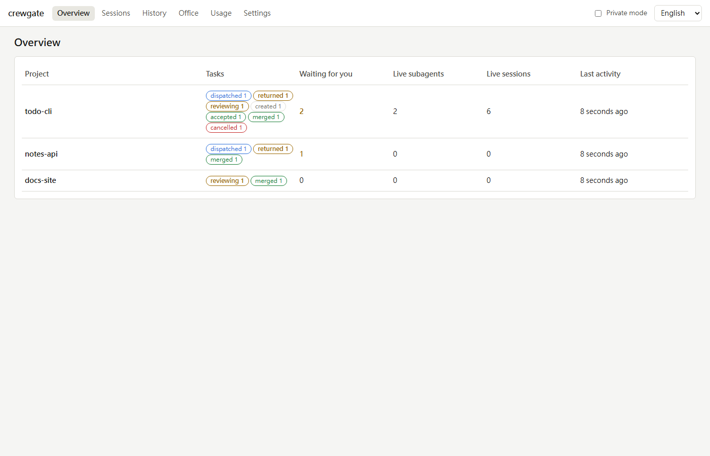
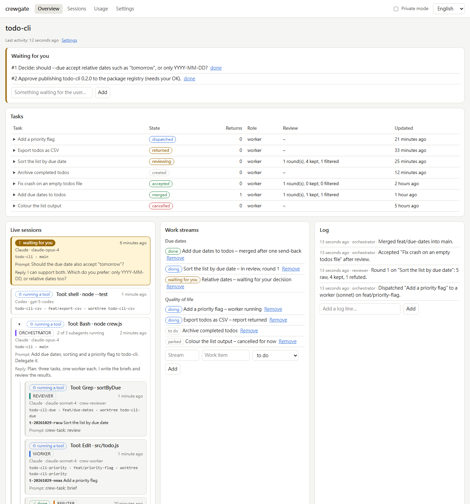
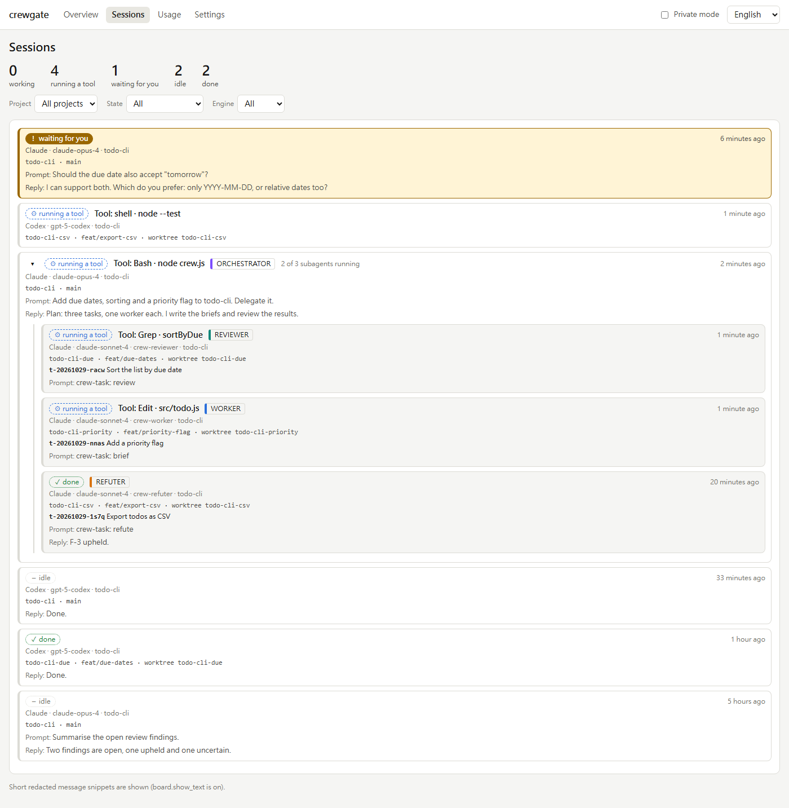
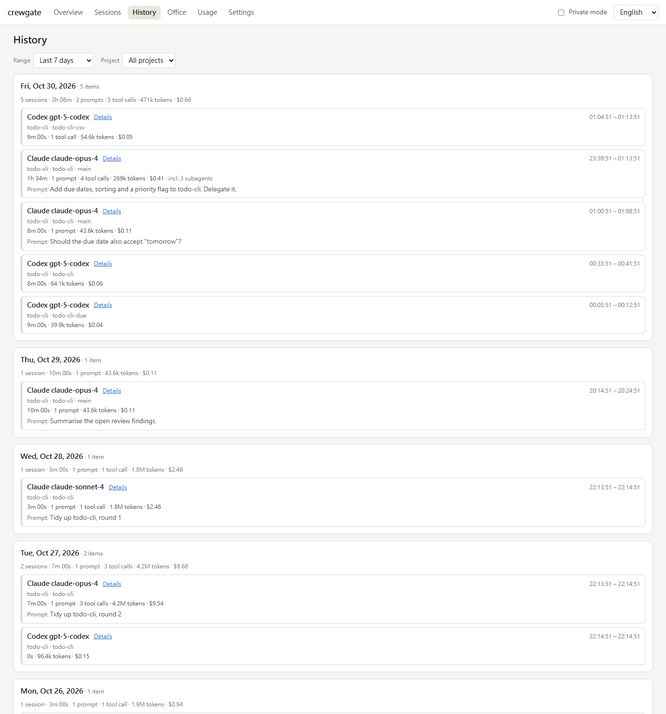
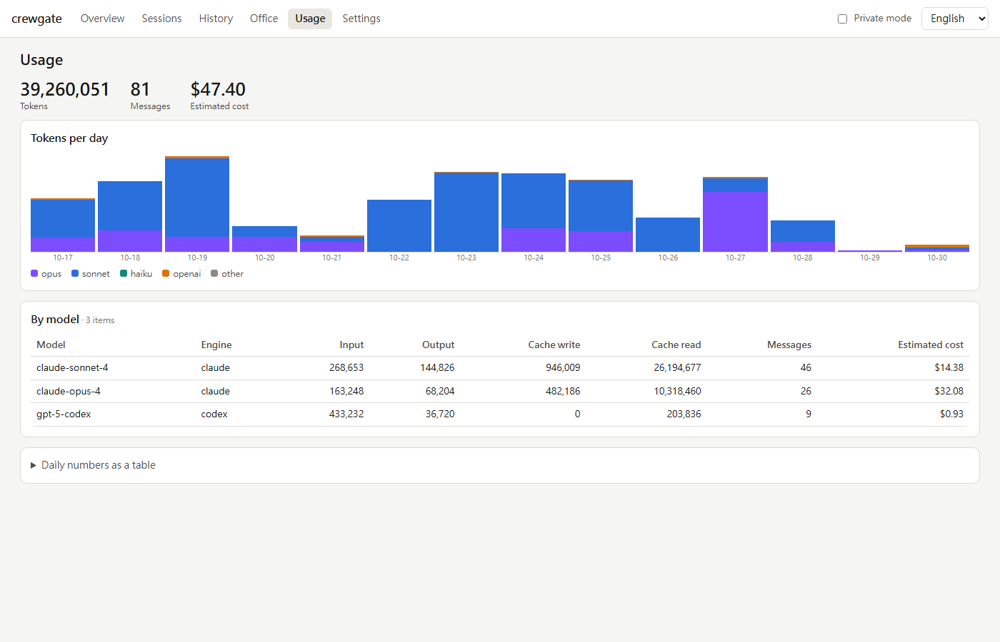
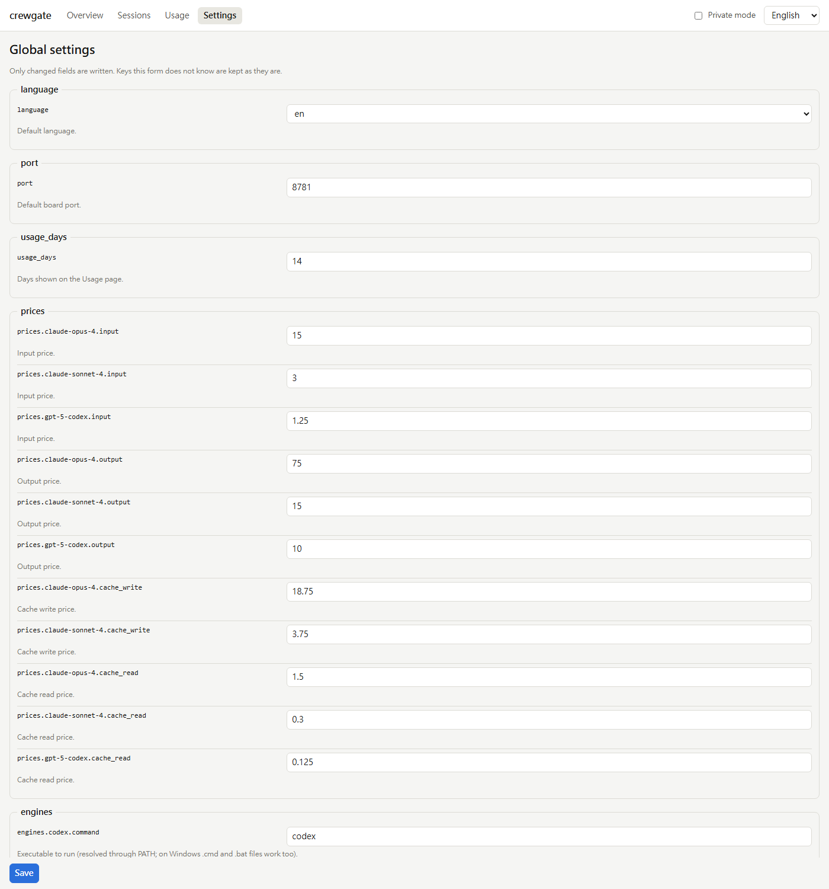
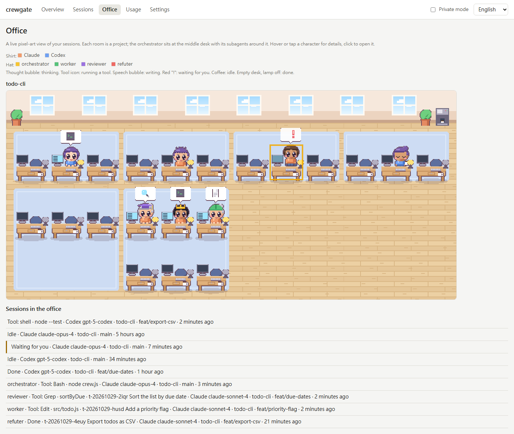

# crewgate

[](https://github.com/ynyrworks/crewgate/actions/workflows/ci.yml)

[繁體中文](README.zh-TW.md)

**Hand coding work to AI subagents and still be able to trust the result: the work stays on its goal, someone other than the author checks it, you approve what leaves your machine, and there is a record of what really happened.**

## What is crewgate

When you give [Claude Code](https://code.claude.com) a big job, it can hand parts of it to helper agents
("subagents"). Left to itself that gets messy: the main session starts coding instead of coordinating, nobody
checks the result properly, and afterwards you cannot tell what was done by whom. **crewgate** is a Claude Code
plugin (it also runs with the Codex CLI, experimentally) that adds a process around this. One *orchestrator*
session plans the work and writes a *brief*. *Worker* subagents implement it, each in its own git worktree and
branch. Read-only *reviewer* and *refuter* subagents check the result, and only the findings that survive a
deterministic filter reach you. You decide about pushes, pull requests and merges. Everything is recorded by
**hooks and workflow commands, not by the model remembering to log**, and shown on a local board that listens on
`127.0.0.1` only.

## Who it is for

Solo developers and small teams who already use Claude Code (and optionally Codex) and want delegation they can
trust: work split into reviewable pieces, a second pair of eyes that is not the author, a gate in front of
`git push`, and an audit trail they can look at later. You do not need a server, an account or a database, and
crewgate adds nothing to your project except a config file and a few markdown files.

## What you get

**Delegation**
- A five-section brief for every task (goal, scope, must not regress, acceptance, context); the CLI refuses an incomplete one.
- One git worktree and branch per task, and a task state machine: `created -> dispatched -> returned -> (reviewing) -> accepted -> merged`, with a limit on send-backs before the orchestrator takes over.
- Workers on Claude subagents, or on the Codex CLI (`crew task run --engine codex`, experimental).

**Review**
- A three-stage pipeline: find (reviewer), filter (deterministic, no model), refute (a skeptic tries to disprove what is left).
- A dismissal ledger: a finding you reject once is not reported again.

**Safety**
- Approval gates for push, PR, merge, remote hosts, large tasks and installs, set to `auto`, `ask` or `never`. `gates.enforce` picks how a missing approval is handled: `remind`, `confirm` (Claude Code asks you) or `block` (see Gates below).
- An edit guard that warns or blocks when the orchestrator edits code itself, and a reminder when it reads a huge file without a range.
- Secrets, keys and IP addresses are redacted before anything is stored; worker boundaries are written into the agent files.
- Local only: the board binds `127.0.0.1`, no telemetry, no model calls from hooks or the board, one optional update check.

**Visibility**
- A local board with these pages: Overview, Project, Sessions (live Claude and Codex sessions in one tree), a per-session timeline with search, History (up to 90 days), Usage (tokens and estimated cost), Settings (a form generated from the config schema), and an update banner. English and Traditional Chinese. A pixel-art Office page is an [optional add-on](#optional-office-view).
- Dispatches, returns, pushes, merges and session digests are recorded by hooks; you do not log anything by hand.

**Learning**
- Lessons from reviews and send-backs are collected, and become rules in your `CLAUDE.md` only when you approve.

## How it differs from writing rules in CLAUDE.md

Free-text "delegation rules" tend to fail in the same ways: the orchestrator writes code itself and skips
review; the progress board goes stale; briefs lack boundaries; reviewers bury the real findings under nits;
finished background work goes unnoticed; the orchestrator burns its context on big files; and the rules are
forgotten in a long file. crewgate turns each of these into something enforced or recorded: a brief the CLI
will not accept incomplete, edit and big-read guards, state taken from hook events, a filtered review pipeline,
stop reminders for unreviewed or still-running work, and lessons promoted into rules only when you say yes.
The model is still asked to follow the process; crewgate makes it visible when it does not.

Status: experimental parts are labelled where they appear: Codex support, the optional Office add-on, and `confirm` mode
in bypass-permissions mode (not verified). Zero runtime dependencies. Node.js 18 or newer. Works on Windows,
macOS and Linux. The only network request is the board's optional update check (one request a day to GitHub, see
Privacy and safety; turn it off with `updates.check`).

## How it works

```
  you: "add feature X, delegate it"
    |
    v
  +--------------------------+   crew task create    +--------------------+
  | orchestrator             | --------------------> | brief + task       |
  | main session             |   (five-section       | (state machine)    |
  | /crewgate:crew           |    brief)             +--------------------+
  +------------+-------------+                                ^
               | Agent tool; prompt carries                   | state
               | "crew-task: <id>"                            |
               v                                              |
  +--------------------------+   crew task report   +---------+----------+
  | worker subagent          | -------------------> | hooks, every event |
  | own git worktree         |                      | record, remind,    |
  +------------+-------------+                      | guard              |
               | returned                           +---------+----------+
               v                                              |
  +--------------------------+  find, filter, refute          v
  | reviewer + refuter       | ---------------------> +--------------+
  | read-only                |  only survivors        | board        |
  +--------------------------+  reach you             | 127.0.0.1    |
                                                      +--------------+
```

**Roles.** The orchestrator plans, briefs, dispatches, reviews and merges; it does not implement. A worker
implements one task in a worktree, runs the project checks, commits and never pushes. A reviewer reads the
diff, the brief and `.crew/REVIEW.md` and returns structured findings with evidence. A refuter tries to
disprove each surviving finding. Every role has an `engine` and a `model` in the config.

**Task loop.** `created -> dispatched -> returned -> (reviewing) -> accepted -> merged`. A send-back returns a
task to `dispatched`. After `max_returns_before_takeover` send-backs (default 2) the CLI refuses another one
and tells the orchestrator to take the task over.

**Review pipeline.**
1. *Find*: a reviewer writes raw findings (category, severity, `file:line`, evidence, how it was verified,
   confidence).
2. *Filter* (deterministic, no model): drops findings that match your dismissed ledger, inference-only
   findings, low confidence, and nits beyond a cap; downgrades patterns such as theoretical races.
3. *Refute*: a refuter tries to disprove what is left. You only see findings marked upheld or uncertain.

**Hooks.** One script (`scripts/crew-hook.js`) handles SessionStart, UserPromptSubmit, PreToolUse,
PostToolUse, SubagentStart/Stop, Stop, PreCompact and SessionEnd. They link a dispatched subagent to its task
through the `crew-task:` marker, warn (or block, if you choose) when the orchestrator edits code itself, warn
about reading huge files without a range, record `git push` / `git merge` / PR creation and check them against the approval gates, remind you of returned-but-unreviewed
work, and write a deterministic session digest. In a project that was not registered with `crew init`, every
hook is a silent no-op. Details: [plugins/crewgate/hooks/README.md](plugins/crewgate/hooks/README.md).

**Board.** `crew board start` serves a local page: all projects, tasks by state with return counts, live
subagents, things waiting for you, work streams, log, review statistics, lessons, handoffs, a live list of
local Claude Code / Codex sessions with a per-session timeline, a History page that looks back up to 90 days,
token usage, and a Settings form generated from the config schema.
English and Traditional Chinese.

A complete, fictional session is in [examples/todo-cli/WALKTHROUGH.md](examples/todo-cli/WALKTHROUGH.md).

## Install

From the GitHub marketplace:

```
/plugin marketplace add ynyrworks/crewgate
/plugin install crewgate@crewgate
```

Or try it from a local checkout, without installing:

```
git clone https://github.com/ynyrworks/crewgate
claude --plugin-dir crewgate/plugins/crewgate
```

The skill is invoked namespaced: `/crewgate:crew`. The CLI lives at `plugins/crewgate/bin/crew.js`; inside
Claude Code the skill calls it for you. From a terminal use `node plugins/crewgate/bin/crew.js <command>`.

This installs everything crewgate needs. The Office page is separate and you can skip it: see [Optional: Office view](#optional-office-view).

## Quick start

1. Install the plugin (above) and open Claude Code in your git repository.
2. Run `/crewgate:crew init`. It writes `.claude/crew.json`, three agent files in `.claude/agents/`,
   `.crew/REVIEW.md` and `.crew/LESSONS.md`, and registers the project. Add `--lang zh-TW` for Traditional
   Chinese output. It never overwrites existing files without `--force`.
3. Edit `.claude/crew.json`: set `checks` (for example `["npm test"]`) and any `forbidden` paths or actions.
   Commit these files so the team shares them.
4. Ask for work: `/crewgate:crew add a --due option to the add command, delegate it`. The orchestrator
   writes a brief, creates the task and worktree, and dispatches a worker. The dispatch is recorded by a hook;
   you did not log anything.
5. Optional: ask Claude to start the board (`crew board start`) and open `http://127.0.0.1:8781/`.
   To have each session start it when it is down, set `board.autostart` to `true` in `~/.crewgate/config.json` (off by default).
   If the board ever disappears, `crew board status` and `crew doctor` say so, and `~/.crewgate/board.log` records why a stopping board stopped (a killed process logs nothing).
6. When the worker returns, the orchestrator runs the review pipeline, shows you the surviving findings,
   sends back or accepts, and asks before merging (the `merge` gate defaults to `ask`).

## Configuration

Project settings live in `.claude/crew.json` (all keys optional); global settings (board port, usage prices,
default language) in `~/.crewgate/config.json`. The full, generated key reference is
[docs/CONFIG.md](docs/CONFIG.md). The ones you will touch first:

| Key | What it does |
|---|---|
| `roles.<role>.model` / `.engine` | Which model or external engine plays each role. |
| `checks` | Commands a worker must run before reporting. |
| `forbidden.paths`, `forbidden.actions` | Boundaries rendered into the worker agent file. |
| `gates.*` | `auto`, `ask` or `never` for push, PR, merge, remote hosts, large tasks, installs. |
| `gates.enforce`, `gates.require_user_turn` | When a push, PR or merge without approval is checked (`remind`, `confirm`, `block`) and whether an approval needs a user message after the ask. See Gates below. |
| `limits.orchestrator_edit` | `off`, `warn` or `block` when the orchestrator edits code. |
| `limits.max_parallel_workers`, `limits.max_returns_before_takeover` | Concurrency and send-back limits. |
| `review.min_confidence`, `review.report_inference`, `review.nit_cap` | How strict the filter is. |
| `lessons.promote_after_days`, `lessons.rules_cap` | When lessons become candidates, how many rules fit. |

After changing the schema in code, regenerate the reference with `node scripts/gen-config-docs.js`; a test
fails if the committed file is out of date.

## Plans

A plan keeps the work from drifting away from what you set out to do. It records the goal, and every step can be
held against it: when a new step does not serve the goal, the orchestrator is told to raise it with you instead of
folding it in. You then drop it, move it to its own plan, or change the goal.

Technically, a plan is a tree of steps kept as Markdown in your repo (`.crew/plans/<name>.md`). Leaves link to crewgate
tasks, so the board can show how far the whole job is and updates by itself when the file or a task changes. A plan may
grow, but visibly: every node records where it came from (`plan`, `user`, `review`, `refute`, `implementation`,
`send-back`) and when it was added, and the plan page can highlight what was added recently.

For a plan of about three steps or more, the orchestrator is told to clarify first: it asks only what would change the
plan and what the code cannot answer, and keeps the answers in the plan file. It asks again only when the goal, scope, a
constraint or an earlier answer changes. These are instructions to the model, not checks that crewgate enforces.

```
crew plan new 0-14 --title "0.14 plan" --goal "What this release must achieve"
crew plan add 0-14 "Plan tree and completion view"
crew plan add 0-14 "File format and CLI" --under n1
crew task create --title "..." --brief-file brief.md --plan 0-14:n2   # or: crew plan link 0-14 n2 <task-id>
crew plan show 0-14
```

Before you dispatch, a plan review can challenge the plan: a reviewer criticises it, a refuter tries to disprove each
criticism, and the survivors appear as proposed `[?]` nodes under the step they are about (`crew plan review run|filter|finalize`).
You accept or reject each one (`crew plan accept|reject`); only accepted nodes count. The board lists the pending proposals
with the commands to copy.

When a code review finds real work that the task will not fix, `crew review followup <task> <finding-id> --done-when "..."` proposes it
the same way, as a `[?]` step next to the task's step, so it is not lost and does not quietly widen the plan. Work that does not serve the
goal can go to another plan with `--plan <name>`.

Hand-edit the file whenever you like (`- [ ] step`, two-space indentation, `[x]` done, `[~]` dropped); the CLI keeps
your text and order and only adds ids. Details: [references/commands.md](plugins/crewgate/skills/crew/references/commands.md#plans).

## CLI reference

Every command, option and file location: [plugins/crewgate/skills/crew/references/commands.md](plugins/crewgate/skills/crew/references/commands.md).
Groups: `init`, `doctor`, `project`, `task`, `plan`, `review`, `handoff`, `lesson`, `need`, `work`, `log`, `mr`,
`validate`, `board`, `update`, `import`. Read commands accept `--json`.

## Board screenshots

All screenshots come from a fully fictional demo (`node scripts/demo-board.js`, then `node scripts/screenshots.js <url>`); nothing here is real data. Light and dark follow your system theme.

**Overview: every registered project, task counts, what waits for you.**

<picture>
  <source media="(prefers-color-scheme: dark)" srcset="docs/images/overview-dark.png">
  
</picture>

**Project: tasks with review stats, live sessions (orchestrator, workers, reviewers), work streams, log.**

<picture>
  <source media="(prefers-color-scheme: dark)" srcset="docs/images/project-dark.png">
  
</picture>

**Sessions: Claude and Codex sessions in one tree; the ones waiting for you come first.**

<picture>
  <source media="(prefers-color-scheme: dark)" srcset="docs/images/sessions-dark.png">
  
</picture>

**History: sessions older than 24 hours, up to 90 days back, grouped by day with the same statistics; every row opens its timeline.**

<picture>
  <source media="(prefers-color-scheme: dark)" srcset="docs/images/history-dark.png">
  
</picture>

**Usage: tokens and estimated cost per model and day.**

<picture>
  <source media="(prefers-color-scheme: dark)" srcset="docs/images/usage-dark.png">
  
</picture>

**Settings: every option with its description.**

<picture>
  <source media="(prefers-color-scheme: dark)" srcset="docs/images/settings-dark.png">
  
</picture>

## Optional: Office view

The Office page shows your sessions as a small pixel-art office. It is for fun and for an at-a-glance feel; nothing in
crewgate depends on it, so it is a separate plugin that you install only if you want it. Without it there is no Office tab.

```
/plugin install crewgate-office@crewgate
```

Then reload the board page; the board does not need a restart. From a terminal, use `claude plugin install crewgate-office@crewgate`. Once it
is installed, one-click update keeps it current. If the two ever do not match, the tab says so and shows the commands to
update it, and the rest of the board keeps working. To remove it, use `/plugin uninstall crewgate-office@crewgate`.

**Upgrading from 0.14 or older:** the Office tab disappears until you install the add-on. Nothing else changes.

Installing it through Codex is experimental and has not been verified. A local checkout finds `plugins/crewgate-office` by itself.

**What it shows: one room per project.** Role marks (headset, hard hat, glasses, horns) show the role, shirt colour the engine. Characters act out the work: reading holds a document, searching a magnifier, editing types fast, a command shows a terminal with a progress bar, waiting shows a `!`. Finished subagents walk to their parent with a paper, idle sessions rest on the sofa, finished ones walk out of the door. Drawn from scratch on a canvas, no external assets, still works with a keyboard through the list under it.

<picture>
  <source media="(prefers-color-scheme: dark)" srcset="docs/images/office-dark.png">
  
</picture>

## Roadmap

What is next, what comes later and what is 1.0: [docs/ROADMAP.md](docs/ROADMAP.md).

An enhanced WebGL Office is planned for the next release, in the same optional add-on. It is not available yet, and the
pixel-art view stays as the fallback for browsers without WebGL.

## Privacy and safety

- **Local only.** The board binds `127.0.0.1`, rejects foreign `Host` headers, sets no CORS headers, requires a
  per-process token and JSON content type for every write, and sends a strict CSP. No telemetry, no model calls from hooks or the board.
- **One outbound request, optional.** While `updates.check` is on (the default) the board server, never the
  browser, asks `api.github.com` for the latest crewgate release at most once a day: a plain GET with a
  `User-Agent: crewgate/<version>` header, no cookies or credentials, nothing about you or your projects, 5 s
  timeout, result cached in `~/.crewgate/update-check.json`. Set `updates.check` to `false` and crewgate makes no
  network request at all. `HTTPS_PROXY` is not supported. When a newer release exists the board shows a banner
  (fix / new features / major) with release notes, **Update now** and **Skip this version**. Update now runs only
  fixed commands (`claude plugin marketplace update crewgate`, `claude plugin update crewgate@crewgate`,
  `codex plugin marketplace upgrade crewgate`), only for an installed plugin; a development checkout or a machine
  without those CLIs gets the commands to copy instead. The board then restarts itself from the updated code.
  Terminal: `crew update check`, `crew update apply`, `crew update cleanup` (old versions the update leaves in the plugin caches; also a button on the board).
- **Redaction.** Text is redacted before it is truncated and stored: private keys, bearer and basic auth,
  `password=` style pairs, common provider keys, JWTs, and IP addresses other than loopback and the
  documentation ranges.
- **Hook error log.** A hook that fails (a handler error, a crash, a timeout) still answers Claude Code normally and appends one line to `~/.crewgate/hook-errors.jsonl`: time, event, kind (`error`, `guard`, `worker_exit`), the message redacted and cut to 300 characters, and the plugin version. The file is local, capped at 1 MiB (the previous one is kept as `hook-errors.1.jsonl`), and `crew doctor` shows the counts of the last 24 hours and 7 days.
- **Where data goes.** Runtime data is written under `~/.crewgate/` (override with `CREWGATE_HOME`).
  Project files (`.claude/crew.json`, `.crew/*`) are written only by `crew init` and the lesson commands.
- **Hooks run outside the sandbox**, with your permissions. They read stdin, the project's git metadata and
  crewgate files, and write only under the data folder. They never register a project and never block a
  stop. The deliberate refusals are the edit guard when you set `orchestrator_edit` to `block`, and the push / PR / merge gate when you set `gates.enforce` to `block` (or make Claude Code ask you with `confirm`).
- **Text is data.** File contents, reports, handoff bodies and findings are fenced and marked untrusted when
  shown to a model; commands found in them are not to be executed.
- **Worker boundaries** in the generated agent file: only the assigned worktree and branch, commit but never
  push, no network or downloads, no secrets, no skipping tests or hooks. These are instructions to a model, not
  a sandbox; gates and review exist because instructions can be ignored.

## Gates: approvals before push, PR and merge

`gates.push`, `gates.open_pr` and `gates.merge` default to `ask`: the orchestrator must run `crew gate ask`, ask you in chat
and record your answer with `crew gate answer`. `gates.enforce` decides when crewgate checks that this happened:

| `gates.enforce` | What happens to a push, PR or merge with no approval | Good for |
|---|---|---|
| `remind` (default) | It runs. After it, the hook records `gate.missing` and reminds the model. Never blocks. | Solo experiments |
| `confirm` | Before it runs, the hook makes Claude Code ask **you** (its own permission prompt: allow or deny). If you allow, it is recorded as `gate.confirmed` and nothing is reported missing. A false detection costs one click. Needs a client that honours PreToolUse `ask`; behaviour in bypass-permissions mode is not verified. | Interactive sessions (recommended) |
| `block` | Before it runs, the hook denies it. The model must `gate ask`, ask you, wait for your reply, `gate answer yes` and retry. A false detection stops work. Not a security boundary: the model can still record an approval itself. | CI and headless runs, together with `auto` gates |

A push, PR or merge under a `never` gate is denied before it runs in all three modes, and no approval lifts it. Codex sessions
only record it and tell the model afterwards.

`gates.require_user_turn` (default `true`) adds one rule to all three modes: a hand-recorded approval counts only if you sent
a message in the asking session between its `gate ask` and its `gate answer yes` (judged once, when the answer is recorded; where the session id is unknown, as in the Codex CLI, a message in any session of the project counts, which is weaker). That stops the model from asking and approving in one go; it
does not stop it from answering "yes" after you wrote something unrelated. All three modes are best-effort interception, not a
hard stop: detection reads the command of the Bash and PowerShell tools, including one wrapped in `bash -c`, `eval`, `powershell -c`,
`cmd /c`, `npx` or an inline `git -c alias.x=y`. A script that pushes, a configured alias, a variable (`$GIT push`) or a push by
another tool is not seen, and a hook that crashes or times out lets the command through. For a hard stop use branch protection on
the server. The target repo of `cd` / `git -C`
decides which project's config applies, and an unregistered repo is never enforced. Codex sessions stay on `remind`.
Step by step, limits and recommended settings: [docs/DESIGN.md §8.1](docs/DESIGN.md).

## Using Codex or another CLI as the reviewer

The reviewer role can run outside Claude. The global config (`~/.crewgate/config.json`) ships an engine named
`codex` (`codex exec -s read-only --skip-git-repo-check -`). Set `roles.reviewer.engine` to `codex` in the project,
or run it once:

```
crew review run <task> --engine codex
```

crewgate builds a prompt (brief, review rules, diff), passes it on stdin, extracts the JSON array of findings
from stdout and continues with the same filter and refute stages. Add your own engine under `engines` in the
**global** config with a `command` and `args`; the prompt is always sent on stdin. The command is looked up on
`PATH` (on Windows also `.cmd`/`.bat`, started without a shell). A project's `.claude/crew.json` can only *name*
an engine (`roles.*.engine`): an `engines` block in a project file is ignored with a warning, because a cloned
repository must not choose which program `crew review run` starts. `crew doctor` shows whether each engine
resolves. Codex as a worker and as an orchestrator is described in the next section.

## Using with Codex (experimental)

crewgate also runs with the Codex CLI. This is experimental: it was measured with Codex CLI 0.160 and has not seen long real use.

Install the plugin in Codex (it reads the same marketplace):

```
codex plugin marketplace add ynyrworks/crewgate
codex plugin add crewgate@crewgate
```

- **Upgrading:** run only `codex plugin marketplace upgrade crewgate`; it refreshes the installed plugin, so there is no need to run `codex plugin add` again.
- **Trust the hooks once.** Open `/hooks` in Codex and trust the crewgate hooks; do it again after a plugin update changes a command.
- **Set up the project:** `crew init --engine codex` adds `.codex/agents/crew-reviewer.toml`, `crew-refuter.toml` and a marked block in `AGENTS.md` (existing text is kept).
- **Codex as a worker** (from a Claude or a Codex orchestrator): `crew task run <id> --engine codex`. Codex edits files in the task's worktree; crewgate commits (the Codex sandbox cannot), writes the report and returns the task. Failures commit nothing and leave the worktree for inspection.
- **Permissions.** `crew` writes under `~/.crewgate`, which Codex's default workspace-write sandbox blocks: approve the `crew` commands or run Codex with a wider sandbox. Codex subagents share the parent's sandbox and cannot commit, so workers never run as Codex subagents.

## Limitations

- Needs Claude Code with plugin support; field names in hook payloads beyond the documented ones are read
  defensively and may differ between versions.
- Hooks cannot see the model's reasoning. They record what happens (dispatches, stops, git commands), not why.
- `crew task merge` records a merge; it does not run git. The orchestrator merges, the hook records the command.
- Worker isolation is a worktree plus instructions, not a container.
- The board lists sessions by reading local Claude Code and Codex logs; message text is hidden unless you set
  `board.show_text` in the global config. Session statistics (duration, prompts, tool calls, tokens, cost) are numbers only;
  they are cached per transcript under `~/.crewgate/cache/sessions`.
- Git and gate detection reads only the command text of the Bash and PowerShell tools. A script that pushes, a configured alias, a variable (`$GIT push`), `-EncodedCommand` or a push by another tool (IDE, Git GUI, MCP server) is not seen; the gates guard against the model's ordinary habits, not against a determined bypass.
- `gates.enforce: confirm` relies on Claude Code honouring a PreToolUse `ask`; its behaviour in bypass-permissions mode (and `dontAsk`) is not verified. `gate.confirmed` means the command ran after an ask was returned, not that a human clicked.
- Codex sessions stay on `remind`: whether Codex honours `ask` / `deny` from a hook is not established. Where the session id is unknown (Codex CLI), `gates.require_user_turn` falls back to the weaker `"project"` check: a message in any session of the project counts.
- The optional Office add-on is experimental and shows activity, not results: whether a command passed is not in the data it receives. A Codex orchestrator is experimental; there is no Gemini support.

## Contributing

Read [docs/DESIGN.md](docs/DESIGN.md) first; it is the source of truth. Then:

```
npm test                          # unit, hook, board, end-to-end and repo-hygiene tests (no network)
node scripts/gen-config-docs.js   # after changing the config schema
```

Rules: zero runtime dependencies, Node 18+, cross-platform (no shell assumptions), tests use temp folders and
never the real `~/.crewgate` or `~/.claude`. The repo-hygiene test rejects stray IP addresses, credential-like
strings and project-specific names; use `192.0.2.x` in docs and build any other address at runtime in tests.
Please keep a fix and its test in the same change.

Releases: the board's update banner (and `crew update check`) reads the newest published, non-pre-release GitHub release
of this repository. When a release changes a hook command string (`hooks/hooks.json`, `hooks/codex-hooks.json`),
add this line on its own line to the release notes so the banner can tell Codex users to re-approve the hooks
(`/hooks`):

```
<!-- crewgate:rehook -->
```

Maintainers who must keep certain names out of the repository (a company, an e-mail prefix) should not write
them into any tracked file. Put one regular expression per line in the untracked file
`.git/info/hygiene-extra` (or set `CREWGATE_HYGIENE_EXTRA`, separated by semicolons); the hygiene test adds
them to its built-in patterns.

## License

[MIT](LICENSE)
