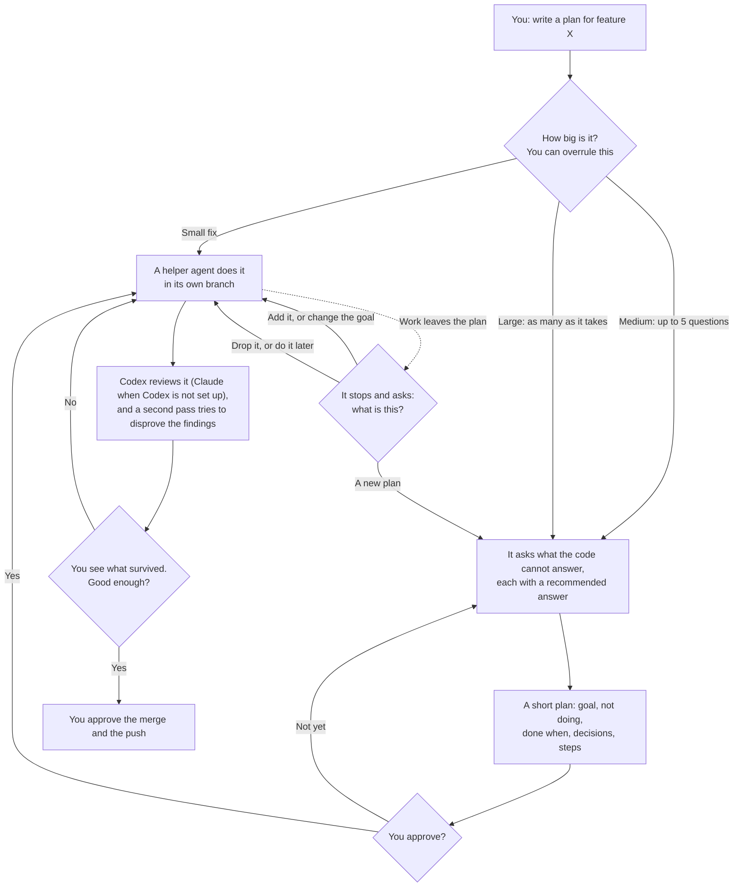
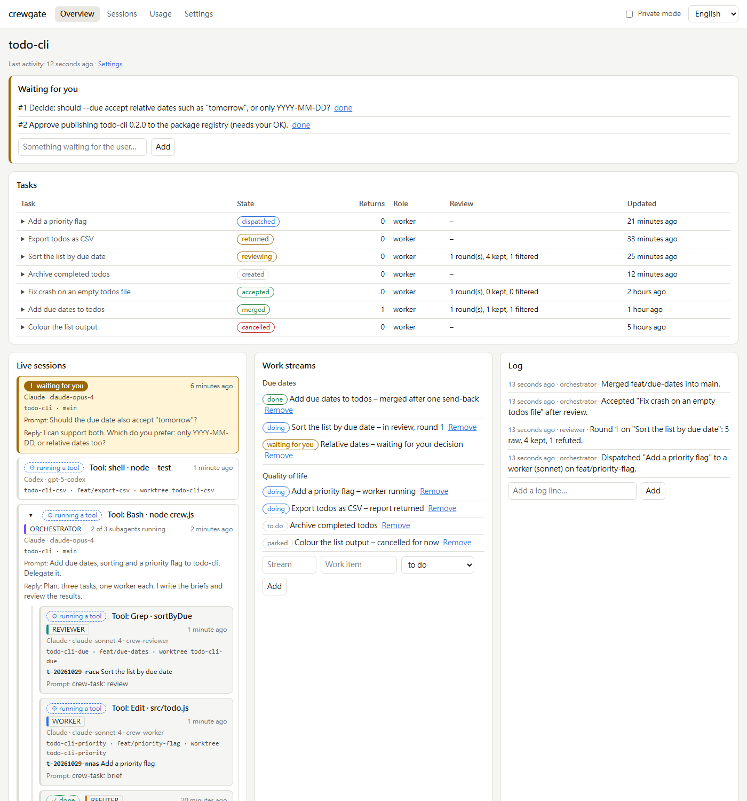

# crewgate

[](https://github.com/ynyrworks/crewgate/actions/workflows/ci.yml)

[繁體中文](README.zh-TW.md)

**Delegate coding work to AI subagents (helper agents that Claude starts), and be sure it does what you want.**

crewgate is a plugin for [Claude Code](https://code.claude.com). You say what you want, and it finds out what you really mean before any work starts. Helper agents do the work. Another agent checks it. You decide what gets merged and pushed.

## Why

Give an AI assistant a big job and it starts fast, then goes wrong in familiar ways:

- It builds what it guessed, because nobody asked what you meant.
- The main session writes code itself, and nobody checks it properly.
- Afterwards you cannot tell what was done, or why.

Rules in `CLAUDE.md` help until they are forgotten. crewgate turns the important ones into checks that stop the work, and records what happened by itself rather than relying on the model to remember.

## How it works



The full flow and the parts behind it are in the [guide](docs/GUIDE.md#how-it-works).

## Get started

In Claude Code:

```
/plugin marketplace add ynyrworks/crewgate
/plugin install crewgate@crewgate
```

Open a new session in your git repository, then:

```
/crewgate:crew init
```

Add `--lang zh-TW` for Traditional Chinese. This writes a config file and a few Markdown files, and changes nothing else. Then just ask:

> Write a plan for adding CSV export.

For a small job, skip the plan:

> /crewgate:crew fix the typo in the README, delegate it.

The model says how big it thinks the job is, and you can overrule it. To approve a plan, reply yes in chat. Plans are Markdown files in `.crew/plans/`. You never need to learn the commands: the model runs them.

## What is enforced, and what is only asked

| | |
|---|---|
| **Stopped by code** | A worker on a plan you have not approved. A plan made final without your reply. An approval given without your message. More workers than the limit. A new worker while the machine is above 85% CPU. An incomplete brief. A change to an approved plan until you answer the drift question. A task with no plan while a plan is final, unless it gives a reason. |
| **Recorded for you to see** | Who did what, every merge and push, what a worker left running, changes to the plan settings, every drift answer and every `--outside-plan`. |
| **Asked of the model, not checked** | Whether its questions were good. Whether the plan caught what you meant. Whether it starts a plan at all: plain words usually reach `/crewgate:plan`, but that is the model's call. Whether a `--outside-plan` reason is true. Work inside the allowed files that goes in the wrong direction. |

These checks read what the model tries to run. A script that pushes is not seen, so for a hard stop, have your Git server refuse direct pushes (branch protection). With no approved plan there is nothing to drift from. See the [roadmap](docs/ROADMAP.md).

## Settings

Change these on the board's Settings page, in `.claude/crew.json`, or by asking in chat:

| Setting | Values | Default |
|---|---|---|
| `plan.interview` | Ask questions before a plan: `on`, `off` | `on` |
| `plan.enforce` | A plan you have not approved: stops the work (`block`), only warns (`remind`), does nothing (`off`) | `block` |
| `plan.review` | When an agent criticises the plan: `large`, `ask`, `off` | `large` |

Everything else is in [docs/CONFIG.md](docs/CONFIG.md).

## See it

A local board shows your projects, plans, tasks and sessions. It is optional, and it listens on `127.0.0.1` only. Ask Claude to start it, or run `crew board start`.

<picture>
  <source media="(prefers-color-scheme: dark)" srcset="docs/images/project-dark.png">
  
</picture>

## Good to know

- **Your machine.** Helper agents run on your computer. Tests are limited, sessions run at low priority, and on Windows a session is capped at 60% CPU. macOS and Linux have no cap yet.
- **Your data.** Nothing leaves your machine except one optional update check a day, with `updates.check` to turn it off. Hooks and the board never call a model.
- **Requirements.** Claude Code with plugin support and Node.js 18 or newer, on Windows, macOS or Linux, with no other dependencies. Codex CLI support is experimental.
- **Status.** Used on a few real projects, still before 1.0. Everything known to be unverified is in the [roadmap](docs/ROADMAP.md).

## Learn more

- [Guide](docs/GUIDE.md): plans, gates, review, the board, Codex, privacy and limits.
- [A complete fictional session](examples/todo-cli/WALKTHROUGH.md).
- [All commands](plugins/crewgate/skills/crew/references/commands.md) and [all settings](docs/CONFIG.md).
- [Design](docs/DESIGN.md), [what changed](CHANGELOG.md), and [where it is going](docs/ROADMAP.md).

## License

[MIT](LICENSE)
