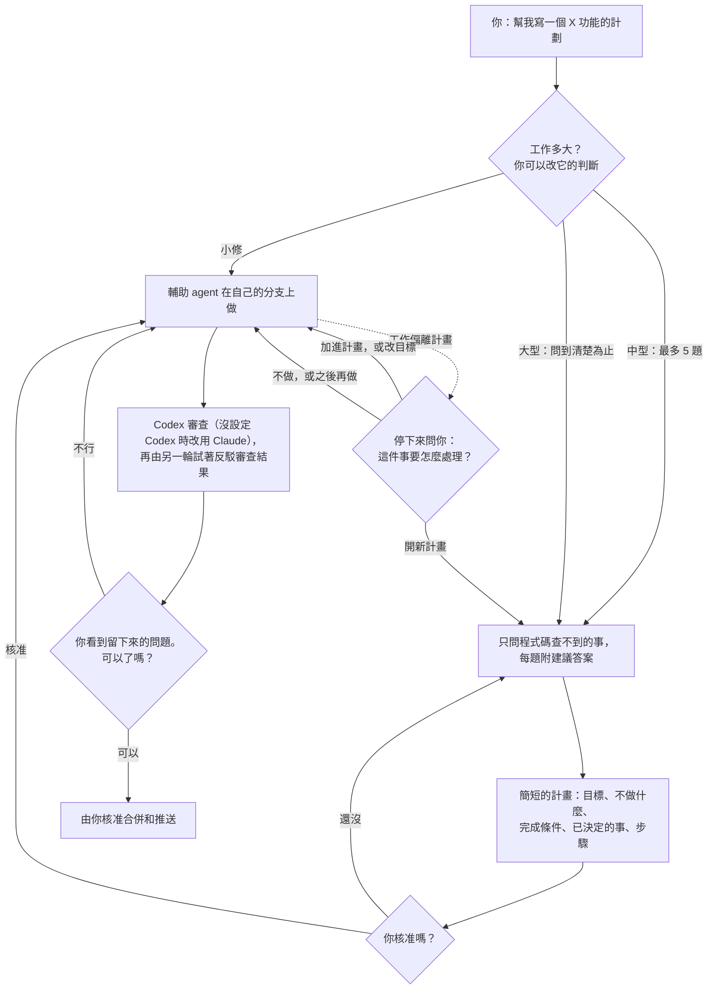
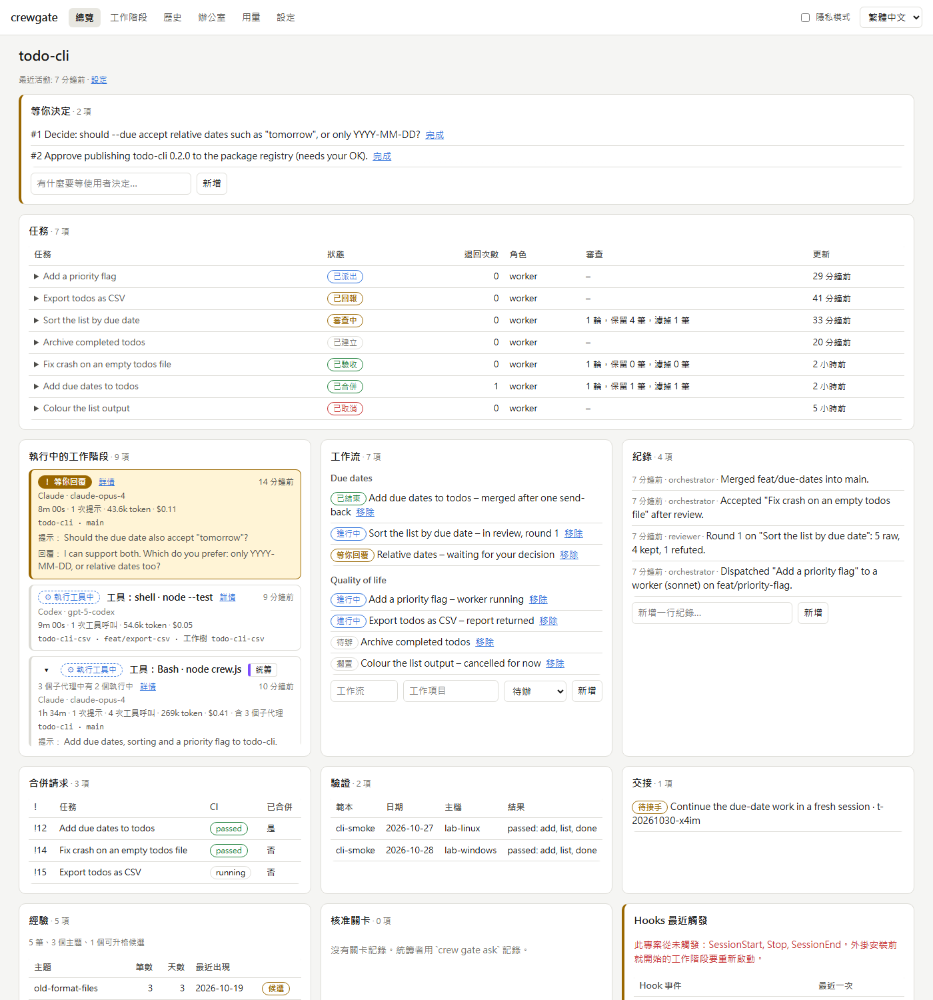

# crewgate

[](https://github.com/ynyrworks/crewgate/actions/workflows/ci.yml)

[English](README.md)

**把寫程式的工作委派給 AI 子代理（由 Claude 啟動的輔助 agent），並確定它做的是你要的。**

crewgate 是 [Claude Code](https://code.claude.com) 的外掛。你說想要什麼，它在開工前先弄清楚你真正的意思。輔助 agent 負責實作，另一個 agent 負責檢查，要不要合併和推送由你決定。

## 為什麼需要它

把大工作交給 AI，一開始很快，接著常常用同樣的方式出錯：

- 沒人問過你的意思，所以它做的是它猜的東西。
- 主對話自己跳下去寫程式，沒有人認真檢查。
- 事後說不清楚做了什麼、為什麼這樣做。

寫在 `CLAUDE.md` 的規則有幫助，但很容易被忘記。crewgate 把重要的規則變成會真的擋下工作的檢查，發生過的事會自動記錄，不靠模型自己記得寫。

## 運作方式



完整流程和背後的元件在[使用指南](docs/GUIDE.zh-TW.md#運作方式)。

## 開始使用

在 Claude Code 裡：

```
/plugin marketplace add ynyrworks/crewgate
/plugin install crewgate@crewgate
```

在你的 git 專案開一個新的工作階段，然後：

```
/crewgate:crew init --lang zh-TW
```

這只會寫入一個設定檔和幾個 Markdown 檔，不會改動其他東西。接著直接說：

> 幫我寫一個匯出 CSV 功能的計劃。

小工作可以跳過計畫：

> /crewgate:crew 修掉 README 的錯字，委派出去。

模型會先說它判斷工作多大，你可以改。要核准計畫，在對話裡回覆「好」就可以。計畫是 `.crew/plans/` 裡的 Markdown 檔。你不需要學任何指令，模型會自己執行。

## 哪些會強制，哪些只是要求

| | |
|---|---|
| **由程式擋下** | 你還沒核准的計畫上的 worker。沒有你回覆就定版的計畫。沒有你的訊息就記錄的核准。超過上限的 worker。全機 CPU 超過 85% 時派新的 worker。不完整的任務書。你回答偏離提問之前，對已核准計畫的修改。有已核准計畫時沒掛計畫、也沒寫原因的任務。 |
| **記錄下來讓你看** | 誰做了什麼、每次合併和推送、worker 留下的行程、計畫設定的變更、每次偏離提問的答案、每次 `--outside-plan`。 |
| **只是要求模型，無法檢查** | 問題問得好不好。計畫有沒有抓到你的意思。會不會開始寫計畫：用白話通常能觸發 `/crewgate:plan`，但這由模型判斷。`--outside-plan` 寫的原因是否屬實。檔案都在範圍內、但方向錯了的工作。 |

這些檢查讀的是模型準備執行的內容。用腳本推送就看不到，要真正擋住，請讓 Git 伺服器拒絕直接推送（分支保護）。沒有已核准的計畫時，就沒有偏離可言。詳見[路線圖](docs/ROADMAP.md)。

## 設定

可以在看板的設定頁、`.claude/crew.json` 修改，或直接在對話裡說：

| 設定 | 選項 | 預設 |
|---|---|---|
| `plan.interview` | 寫計畫前要不要提問：`on`、`off` | `on` |
| `plan.enforce` | 你還沒核准的計畫：擋下工作（`block`）、只提醒（`remind`）、不處理（`off`） | `block` |
| `plan.review` | 什麼時候由 agent 批評計畫：`large`、`ask`、`off` | `large` |

其他設定都在 [docs/CONFIG.md](docs/CONFIG.md)。

## 看看畫面

本機看板會顯示專案、計畫、任務和工作階段。它是選用的，只綁定 `127.0.0.1`。請 Claude 啟動它，或執行 `crew board start`。

<picture>
  <source media="(prefers-color-scheme: dark)" srcset="docs/images/project-dark-zh-TW.png">
  
</picture>

## 你應該知道的

- **你的電腦。** 輔助 agent 跑在你的電腦上。測試數量有限制，工作階段以低優先權執行，Windows 上每個工作階段的 CPU 上限是 60%。macOS 和 Linux 目前沒有上限。
- **你的資料。** 除了每天一次可關閉的更新檢查（`updates.check`），沒有東西會離開你的電腦。Hook 和看板都不會呼叫模型。
- **需求。** 支援外掛的 Claude Code 和 Node.js 18 以上，可在 Windows、macOS、Linux 執行，沒有其他相依套件。Codex CLI 支援是實驗性的。
- **狀態。** 已用在幾個真實專案，還沒到 1.0。所有已知未驗證的項目都在[路線圖](docs/ROADMAP.md)。

## 延伸閱讀

- [使用指南](docs/GUIDE.zh-TW.md)：計畫、關卡、審查、看板、Codex、隱私和限制。
- [一段完整的虛構工作階段](examples/todo-cli/WALKTHROUGH.md)。
- [所有指令](plugins/crewgate/skills/crew/references/commands.md)和[所有設定](docs/CONFIG.md)。
- [設計文件](docs/DESIGN.md)、[變更紀錄](CHANGELOG.md)和[未來方向](docs/ROADMAP.md)。

## 授權

[MIT](LICENSE)
