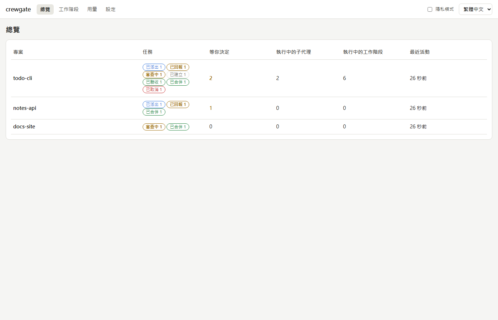
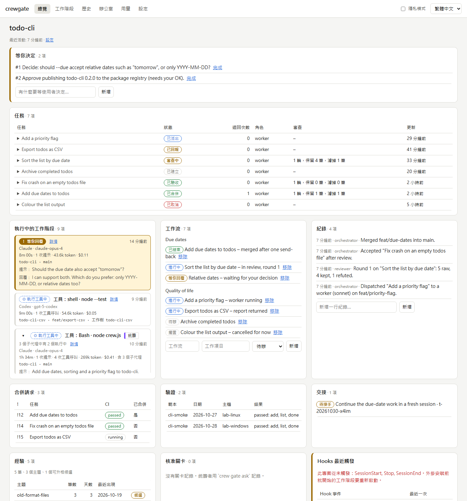
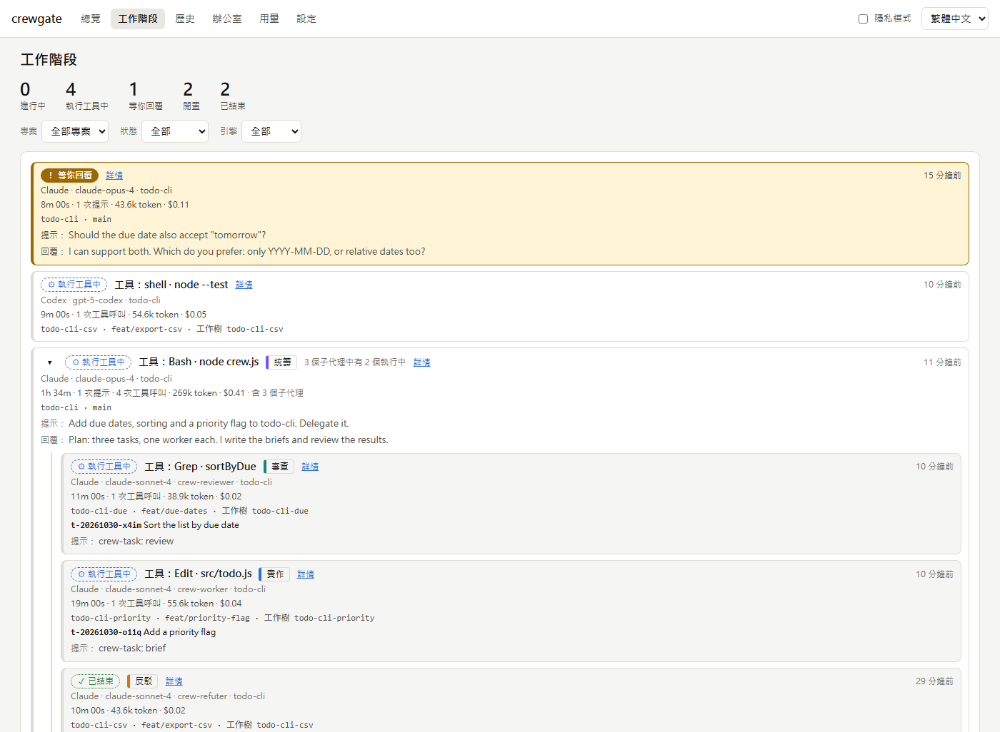
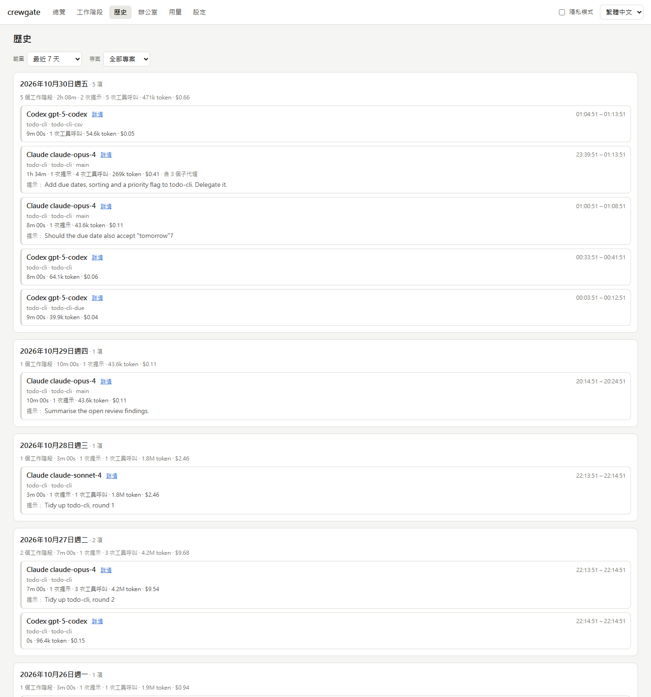
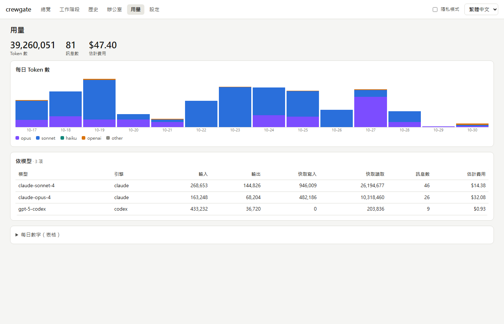
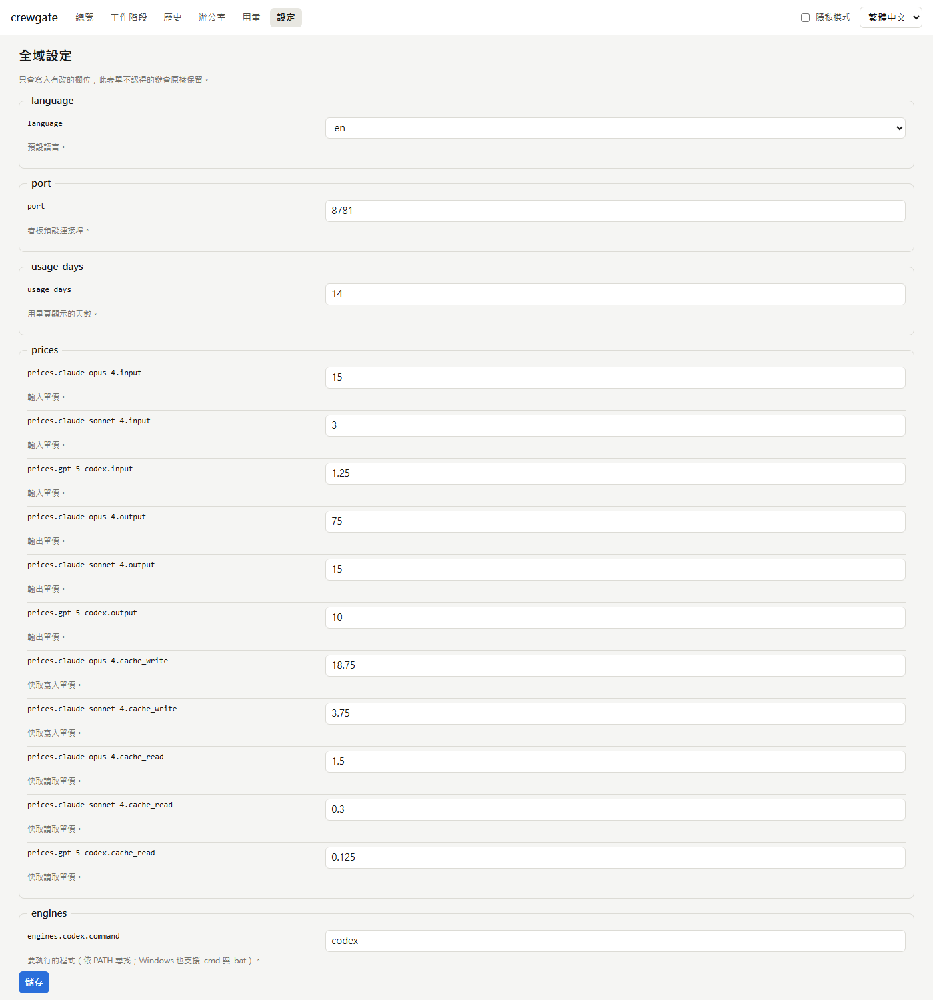
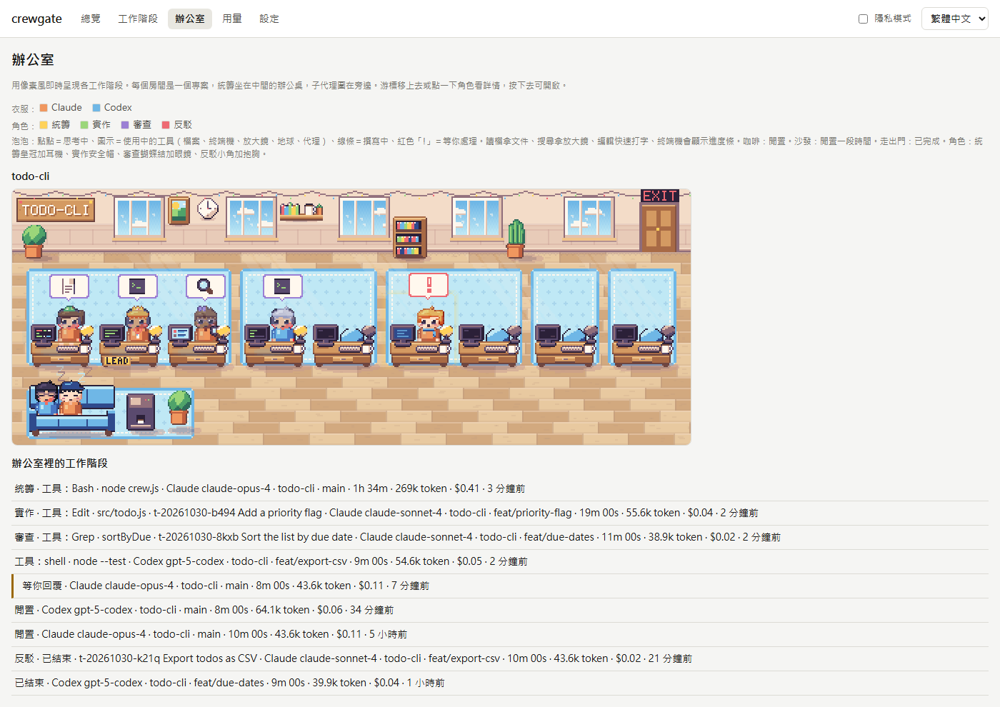

# crewgate

[](https://github.com/ynyrworks/crewgate/actions/workflows/ci.yml)

[English](README.md)

**把寫程式的工作交給 AI 子代理，成果仍然信得過：工作不偏離目標、由作者以外的人檢查、離開本機的東西由你核准，而且留有一份真實發生過什麼的紀錄。**

## crewgate 是什麼

請 [Claude Code](https://code.claude.com) 處理大一點的工作時，它可以把其中一部分交給輔助的代理（「子代理」）去做。
放著不管，場面很容易亂：主對話自己跳下去寫程式、沒人認真檢查成果，事後也說不清楚誰做了什麼。**crewgate** 是一個
Claude Code 外掛（也能搭配 Codex CLI，目前屬實驗性），在這件事外面加上一套流程：由一個**統籌**（orchestrator）工作階段
規劃並寫下**任務書**（brief），**實作者**（worker）子代理各自在獨立的 git worktree 與分支裡實作，唯讀的**審查員**
（reviewer）與**反駁員**（refuter）子代理負責檢查成果，只有通過決定性過濾的發現才會送到你面前；要不要推送、開 PR、
合併，由你決定。所有紀錄都由 **hook 與流程指令自動寫下，不靠模型自己記得去記**，並顯示在只監聽 `127.0.0.1` 的本機看板上。

## 適合誰

已經在用 Claude Code（也可能用 Codex）的個人開發者與小團隊，想要「可以放心交辦」的分工：工作切成可審查的小塊、
有一雙不是作者本人的眼睛來檢查、`git push` 前有一道關卡，事後還能回頭查紀錄。不需要伺服器、帳號或資料庫；
crewgate 除了一個設定檔和幾個 markdown 檔之外，不會在你的專案裡放任何東西。

## 你會得到什麼

**分工**
- 每件任務都有五段式任務書（目標、範圍、不可退化、驗收、脈絡），缺段落 CLI 直接拒收。
- 每件任務一個 git worktree 與分支，以及任務狀態機：`created -> dispatched -> returned -> (reviewing) -> accepted -> merged`；退回達到上限後，統籌改為自己接手。
- 實作者可以是 Claude 子代理，也可以是 Codex CLI（`crew task run --engine codex`，實驗性）。

**審查**
- 三段式流程：找出（審查員）、過濾（決定性、不用模型）、反駁（反駁員試著推翻剩下的發現）。
- 駁回清單：你駁回過的發現不會再被提出來。

**安全**
- 推送、PR、合併、遠端主機、大型任務、安裝下載都有關卡，可設為 `auto`、`ask` 或 `never`；沒有核准時怎麼處理由 `gates.enforce` 決定：`remind`（提醒）、`confirm`（讓 Claude Code 問你）或 `block`（擋下），見下方「關卡」。
- 統籌自己動手改程式時，編輯守門會提醒或擋下；不帶範圍就讀超大檔案時也會提醒。
- 金鑰、憑證與 IP 位址會先遮蔽再儲存；實作者的界線寫進 agent 檔。
- 只在本機：看板只綁定 `127.0.0.1`，沒有遙測，hook 與看板不會呼叫模型，只有一個可關閉的更新檢查。

**可見度**
- 本機看板的頁面：總覽、專案、工作階段（Claude 與 Codex 的即時工作階段併在同一棵樹）、含搜尋的單一工作階段時間軸、歷史（最多回溯 90 天）、用量（token 與估算費用）、設定（由設定結構產生的表單），以及更新橫幅。支援英文與繁體中文。像素風的辦公室頁面是[選用的附加元件](#選用辦公室畫面)。
- 派工、交回、push、merge 與工作階段摘要都由 hook 記錄，你不用手動記任何東西。

**學習**
- 審查與退回中得到的經驗會被收集起來，只有你點頭才會升格成 `CLAUDE.md` 裡的規則。

## 和直接在 CLAUDE.md 寫規則有什麼不同

只靠文字規則來分工，常常一再出現同樣的問題：統籌自己寫程式、跳過審查；看板過時或漏記；任務書沒有邊界；
審查員的瑣碎意見淹沒真正的問題；背景工作做完卻沒人發現；統籌把上下文耗在大檔案上；規則寫在一大段文字裡，寫了就被忘記。
crewgate 把這些都變成強制或自動記錄的機制：缺段落就拒收的任務書、改程式與讀大檔的提醒、由 hook 事件記錄的狀態、
經過過濾的審查流程、尚未審查或仍在背景執行時的收尾提醒，以及只有你點頭才會升格成規則的經驗。
模型仍然是被「要求」照流程走；crewgate 做的是，一旦沒照做，你看得到。

現況：實驗性的部分都在出現的地方標示出來：Codex 支援和選用的辦公室附加元件。已知問題列在[路線圖](docs/ROADMAP.md)。
沒有任何執行期相依套件，需要 Node.js 18 以上，Windows、macOS、Linux 都能用。唯一的對外連線是看板選用的更新檢查
（一天向 GitHub 一次，見「隱私與安全」，可用 `updates.check` 關閉）。

## 運作方式

```
  你：「幫我做功能 X，分工去做」
    |
    v
  +--------------------------+   crew task create    +--------------------+
  | 統籌 orchestrator        | --------------------> | 任務書 + 任務      |
  | 主工作階段               |   （五段式任務書）    | （狀態機）         |
  | /crewgate:crew           |                       +--------------------+
  +------------+-------------+                                ^
               | Agent 工具；提示詞帶有                       | 狀態
               | "crew-task: <id>"                            |
               v                                              |
  +--------------------------+   crew task report   +---------+----------+
  | 實作子代理 worker        | -------------------> | hook（每個事件）   |
  | 自己的 git worktree      |                      | 記錄、提醒、守門   |
  +------------+-------------+                      |                    |
               | 回報                               +---------+----------+
               v                                              |
  +--------------------------+  找出、過濾、反駁              v
  | 審查員 + 反駁員          | ---------------------> +--------------+
  | 唯讀                     |  只有倖存的發現        | 看板         |
  +--------------------------+  會送到你面前          | 127.0.0.1    |
                                                      +--------------+
```

**角色。** 統籌負責規劃、寫任務書、派工、審查與合併，自己不實作。實作者在 worktree 裡完成一件任務，跑專案的檢查、
commit，絕不 push。審查員讀 diff、任務書與 `.crew/REVIEW.md`，回傳附證據的結構化發現。反駁員試著推翻每一筆倖存的發現。
每個角色在設定檔裡都有自己的 `engine` 與 `model`。

**任務流程。** `created -> dispatched -> returned -> (reviewing) -> accepted -> merged`。退回會讓任務回到
`dispatched`。退回次數達到 `max_returns_before_takeover`（預設 2）後，CLI 會拒絕再退回，並提示統籌自己接手。

**審查流程。**
1. *找出*：審查員寫出原始發現（類別、嚴重度、`file:line`、證據、驗證方式、信心）。
2. *過濾*（決定性、不用模型）：濾掉符合「已駁回清單」的、只憑推論的、信心太低的，以及超過上限的瑣碎意見；
   理論上的競態等型態會降為瑣碎意見。
3. *反駁*：反駁員試著推翻剩下的發現。你只會看到判定為成立或不確定的。

**Hook。** 同一支腳本（`scripts/crew-hook.js`）處理 SessionStart、UserPromptSubmit、PreToolUse、PostToolUse、
SubagentStart/Stop、Stop、PreCompact 與 SessionEnd。它們透過 `crew-task:` 標記把派出去的子代理對應到任務；統籌自己
改程式時提醒（或依設定直接擋下）；不帶範圍讀超大檔案時提醒；記錄 `git push`、`git merge` 與建立 PR，並對照核准關卡檢查；有已回報卻未審查的工作時提醒；
並在工作階段結束時寫下決定性的摘要。沒有用 `crew init` 登錄的專案，所有 hook 都是靜默的空操作。詳見
[plugins/crewgate/hooks/README.md](plugins/crewgate/hooks/README.md)。

**看板。** `crew board start` 會啟動本機網頁：所有專案、依狀態排列的任務與退回次數、執行中的子代理、等你處理的事項、
工作流、紀錄、審查統計、經驗、交接、本機 Claude Code / Codex 工作階段即時清單與單一工作階段時間軸、可回溯 90 天的歷史頁、token 用量，以及由設定結構產生的設定頁。
支援英文與繁體中文。

完整的虛構示範流程請看 [examples/todo-cli/WALKTHROUGH.md](examples/todo-cli/WALKTHROUGH.md)（英文）。

## 安裝

從 GitHub marketplace 安裝：

```
/plugin marketplace add ynyrworks/crewgate
/plugin install crewgate@crewgate
```

或是不安裝，直接用本機複本試用：

```
git clone https://github.com/ynyrworks/crewgate
claude --plugin-dir crewgate/plugins/crewgate
```

技能要加上外掛名稱來呼叫：`/crewgate:crew`。CLI 位於 `plugins/crewgate/bin/crew.js`；在 Claude Code 裡由技能代你呼叫，
在終端機則用 `node plugins/crewgate/bin/crew.js <指令>`。

這樣就裝好 crewgate 需要的一切。辦公室頁面是分開的，可以不裝：見[選用：辦公室畫面](#選用辦公室畫面)。

## 快速開始

1. 安裝外掛（見上方），在你的 git 專案裡開啟 Claude Code。
2. 執行 `/crewgate:crew init`。它會建立 `.claude/crew.json`、`.claude/agents/` 下的三個 agent 檔、
   `.crew/REVIEW.md` 與 `.crew/LESSONS.md`，並登錄專案。想要繁體中文輸出可加 `--lang zh-TW`。
   已存在的檔案不加 `--force` 絕不會被覆蓋。
3. 編輯 `.claude/crew.json`：設定 `checks`（例如 `["npm test"]`）以及要禁止的 `forbidden` 路徑或動作，
   然後 commit，讓團隊共用。
4. 交代工作：`/crewgate:crew 幫 add 指令加上 --due 選項，分工去做`。統籌會寫任務書、建立任務與 worktree，
   並派出實作者。派工由 hook 自動記錄，你不需要手動記任何東西。
5. 選用：請 Claude 啟動看板（`crew board start`），再開啟 `http://127.0.0.1:8781/`。
   想讓每個工作階段在看板沒執行時自動啟動，可在 `~/.crewgate/config.json` 把 `board.autostart` 設為 `true`（預設關閉）。
   看板若不見了，`crew board status` 與 `crew doctor` 會提示；`~/.crewgate/board.log` 會記下看板停止的原因（被強制終止的程序不會留下紀錄）。
6. 實作者回報後，統籌會跑審查流程、把倖存的發現給你看，決定退回或驗收，並在合併前先問你（`merge` 關卡預設是 `ask`）。

## 設定

專案設定在 `.claude/crew.json`（所有欄位都是選填）；全域設定（看板連接埠、用量單價、預設語言）在
`~/.crewgate/config.json`。完整的欄位對照表由程式自動產生：[docs/CONFIG.md](docs/CONFIG.md)（含繁體中文說明）。
最常會動到的欄位：

| 欄位 | 用途 |
|---|---|
| `roles.<角色>.model` / `.engine` | 各角色使用的模型或外部引擎。 |
| `checks` | 實作者回報前必須執行的指令。 |
| `forbidden.paths`、`forbidden.actions` | 寫進實作者 agent 檔的禁止事項。 |
| `gates.*` | 推送、開 PR、合併、遠端主機、大型任務、安裝下載各自用 `auto`、`ask` 或 `never`。 |
| `gates.enforce`、`gates.require_user_turn` | 沒有核准的推送、PR、合併何時檢查（`remind`、`confirm`、`block`），以及核准是否需要使用者在 ask 之後送出訊息。見下方「關卡」。 |
| `limits.orchestrator_edit` | 統籌自己改程式時：`off`、`warn` 或 `block`。 |
| `limits.max_parallel_workers`、`limits.max_returns_before_takeover` | 同時實作者數與退回次數上限。 |
| `review.min_confidence`、`review.report_inference`、`review.nit_cap` | 過濾的嚴格程度。 |
| `lessons.promote_after_days`、`lessons.rules_cap` | 經驗何時成為候選、規則最多幾條。 |

修改程式裡的設定結構後，請執行 `node scripts/gen-config-docs.js` 重新產生對照表；已提交的檔案若過期，測試會失敗。

## 計畫

計畫是用來避免工作偏離原本要做的事。它記下目標，每個步驟都能拿來對照：新步驟對目標沒有幫助時，統籌者會被要求先提出來問你，
而不是直接併進去。你可以捨棄它、移到另一份計畫，或修改目標。

技術上，計畫是放在專案裡的 Markdown 步驟樹（`.crew/plans/<名稱>.md`）。葉節點連到 crewgate 任務，看板就能顯示整件工作做到哪裡，
檔案或任務一變動就自動更新。計畫可以長大，但過程看得見：每個節點都記錄來源（`plan`、`user`、`review`、`refute`、`implementation`、
`send-back`）與加入日期，計畫頁可以標出最近新增的節點。

大約三步以上的計畫，統籌者會被要求先釐清：只問會改變計畫、且程式碼查不到的事，答案留在計畫檔裡。之後只有目標、範圍、限制或先前的答案變動時才再問。
這些是給模型的指示，不是 crewgate 會強制檢查的規則。

```
crew plan new 0-14 --title "0.14 計畫" --goal "這個版本必須達成的事"
crew plan add 0-14 "計畫樹與完成度檢視"
crew plan add 0-14 "檔案格式與 CLI" --under n1
crew task create --title "..." --brief-file brief.md --plan 0-14:n2   # 或：crew plan link 0-14 n2 <任務 id>
crew plan show 0-14
```

派工前可以先做計畫審查：審查者批評計畫、反駁者嘗試推翻每一點，留下來的變成掛在對應步驟底下的提議中 `[?]` 節點（`crew plan review run|filter|finalize`）。
你逐一接受或拒絕（`crew plan accept|reject`），只有接受的節點才計入進度；看板會列出等待決定的提議與可複製的指令。

程式碼審查發現真實問題、但這個任務不會修時，`crew review followup <任務> <發現 id> --done-when "..."` 會用同樣的方式提議：在任務步驟旁邊加一個 `[?]` 步驟，工作不會遺失，也不會悄悄把計畫撐大。對目標沒有幫助的工作可以用 `--plan <名稱>` 放到另一份計畫。

你也可以直接手改檔案（`- [ ] 步驟`、兩格縮排、`[x]` 完成、`[~]` 放棄）；CLI 會保留你的文字與順序，只補上 id。
細節見 [references/commands.md](plugins/crewgate/skills/crew/references/commands.md#plans)。

## CLI 參考

所有指令、選項與檔案位置：[plugins/crewgate/skills/crew/references/commands.md](plugins/crewgate/skills/crew/references/commands.md)。
指令群組：`init`、`doctor`、`project`、`task`、`plan`、`review`、`handoff`、`lesson`、`need`、`work`、`log`、`mr`、
`validate`、`board`、`update`、`import`。讀取類指令都支援 `--json`。

## 看板截圖

所有截圖都來自完全虛構的示範資料（`node scripts/demo-board.js`，再執行 `node scripts/screenshots.js <網址>`），沒有任何真實資料。淺色與深色會跟著系統主題。

**總覽：所有已登錄專案、任務數量、等你處理的事。**

<picture>
  <source media="(prefers-color-scheme: dark)" srcset="docs/images/overview-dark-zh-TW.png">
  
</picture>

**專案：任務與審查統計、即時工作階段（統籌、worker、審查員）、工作流、日誌。**

<picture>
  <source media="(prefers-color-scheme: dark)" srcset="docs/images/project-dark-zh-TW.png">
  
</picture>

**工作階段：Claude 與 Codex 併在同一棵樹，等你回覆的排最前面。**

<picture>
  <source media="(prefers-color-scheme: dark)" srcset="docs/images/sessions-dark-zh-TW.png">
  
</picture>

**歷史：超過 24 小時的工作階段，最多回溯 90 天，依日期分組並附同樣的統計；每一列都能點開它的時間軸。**

<picture>
  <source media="(prefers-color-scheme: dark)" srcset="docs/images/history-dark-zh-TW.png">
  
</picture>

**用量：依模型與日期的 token 與估算費用。**

<picture>
  <source media="(prefers-color-scheme: dark)" srcset="docs/images/usage-dark-zh-TW.png">
  
</picture>

**設定：每個選項都有說明。**

<picture>
  <source media="(prefers-color-scheme: dark)" srcset="docs/images/settings-dark-zh-TW.png">
  
</picture>

## 選用：辦公室畫面

辦公室頁面用像素風小辦公室呈現你的工作階段，好玩，也能一眼看個大概。crewgate 的任何功能都不依賴它，所以它是獨立的外掛，想用的人才安裝；沒裝就不會有辦公室分頁。

```
/plugin install crewgate-office@crewgate
```

它約佔 2 MB。裝好後重新整理看板頁面即可，看板不用重啟。在終端機則用 `claude plugin install crewgate-office@crewgate`。裝好之後，一鍵更新會一併更新它；萬一兩邊對不上，分頁會說明並顯示更新指令，看板其他部分照常運作。要移除時用 `/plugin uninstall crewgate-office@crewgate`。

**從 0.14 或更舊的版本升級：** 辦公室分頁會消失，安裝附加元件後才會回來。其他都不受影響。

透過 Codex 安裝屬實驗性，尚未驗證。本機複本會自動找到 `plugins/crewgate-office`。

**兩種畫面，每個專案一個房間。** 預設是像素畫面。**HD 畫面**是需要自己開啟的**測試版**，一次顯示一個房間，呈現 HD-2D 遊戲風格的微縮場景：像素角色與家具站在 3D 房間裡，有窗外灑入的陽光、閃爍的壁燈和微縮模型般的模糊。頭上的標記代表角色；舉手和紅色 `!` 代表正在等你回覆。一個房間最多顯示 8 個角色，等待中的優先，其餘留在下方清單。畫面最多每秒繪製 30 次，分頁隱藏時完全停止。

**像素畫面**同時顯示所有房間，全部由程式繪製。角色標記（耳麥、安全帽、眼鏡、角）代表角色，衣服顏色代表引擎。角色會照工作內容演出：讀檔拿著文件、搜尋拿放大鏡、編輯時快速打字、執行指令時顯示終端機與進度條、等你回覆時冒出 `!`。做完的子代理會拿著文件走向上層，閒置的工作階段到沙發休息，結束的會從門走出去。

按鈕可以切換兩種畫面，頁面會在瀏覽器記住你的選擇。瀏覽器不支援 WebGL，或 HD 畫面在你的機器上太慢時，頁面會改用像素畫面並說明原因。兩種畫面都能透過下方清單用鍵盤操作。

**HD 畫面的美術素材是 AI 生成的**（OpenAI 圖片生成，再處理成像素圖），並使用 [three.js](https://threejs.org)，只有顯示該畫面時才載入。細節與限制見 [plugins/crewgate-office/ART.md](plugins/crewgate-office/ART.md)（英文）。主外掛仍然沒有任何相依套件。

**HD 測試版的已知缺口：**色調與前景尚未完成，在內顯上的效能還沒量測，約佔 2 MB。

<picture>
  <source media="(prefers-color-scheme: dark)" srcset="docs/images/office-dark-zh-TW.png">
  
</picture>

## 路線圖

接下來、之後要做的事，以及 1.0 的條件：[docs/ROADMAP.md](docs/ROADMAP.md)（英文）。


## 隱私與安全

- **只在本機。** 看板只綁定 `127.0.0.1`，會拒絕不符的 `Host` 標頭，不送 CORS 標頭，所有寫入都要帶每次啟動產生的
  token 並使用 JSON 內容類型，並送出嚴格的 CSP。沒有遙測，hook 與看板也不會呼叫模型。
- **唯一的對外連線，可關閉。** `updates.check` 開啟時（預設），由看板伺服器（不是瀏覽器）每天最多一次向
  `api.github.com` 查詢最新的 crewgate 版本：單純的 GET，帶 `User-Agent: crewgate/<版本>`，沒有 cookie 或認證，
  不含任何關於您或專案的資料，逾時 5 秒，結果快取在 `~/.crewgate/update-check.json`。把 `updates.check` 設為
  `false` 就完全不發出網路請求。不支援 `HTTPS_PROXY`。有新版時看板頂端會出現橫幅（修正／新功能／大版本）、
  版本說明連結、「立即更新」與「略過此版本」。立即更新只會執行固定指令（`claude plugin marketplace update crewgate`、
  `claude plugin update crewgate@crewgate`、`codex plugin marketplace upgrade crewgate`），且只限已安裝的外掛；
  開發用的 checkout 或沒有這些 CLI 的機器只會顯示可複製的指令。更新後看板會用新程式自動重新啟動。
  終端機：`crew update check`、`crew update apply`、`crew update cleanup`（移除更新後留在外掛快取的舊版本，看板上也有按鈕）。
- **遮蔽。** 文字會先遮蔽再截斷才儲存：私鑰、Bearer／Basic 認證、`password=` 之類的鍵值、常見服務金鑰、JWT，
  以及除了本機迴路與文件保留網段以外的 IP 位址。
- **Hook 錯誤紀錄。** hook 失敗（處理程式出錯、當掉、逾時）時，仍會正常回應 Claude Code，並在 `~/.crewgate/hook-errors.jsonl` 追加一行：時間、事件、種類（`error`、`guard`、`worker_exit`）、遮蔽後並截斷到 300 字的訊息，以及外掛版本。檔案只在本機，上限 1 MiB（前一份保留為 `hook-errors.1.jsonl`），`crew doctor` 會顯示最近 24 小時與 7 天的筆數。
- **資料放哪裡。** 執行期資料寫在 `~/.crewgate/`（可用 `CREWGATE_HOME` 改位置）。專案內的檔案
  （`.claude/crew.json`、`.crew/*`）只會由 `crew init` 與經驗相關指令寫入。
- **Hook 在沙盒之外執行**，使用你自己的權限。它們只讀取標準輸入、專案的 git 資訊與 crewgate 的檔案，只寫入資料目錄。
  它們不會自動登錄專案，也不會擋住 Stop。刻意的拒絕只有兩種：你把 `orchestrator_edit` 設成 `block` 時的編輯守門，以及把 `gates.enforce` 設成 `block`（或用 `confirm` 讓 Claude Code 問你）時的推送／PR／合併關卡。
- **文字一律當資料。** 檔案內容、報告、交接內容與審查發現，交給模型時都會加上圍欄並標示為不可信，
  裡面出現的指令不應被執行。
- **實作者的界線**寫在產生出來的 agent 檔：只在指定的 worktree 與分支工作、可以 commit 但絕不 push、
  不連網不下載、不碰機敏資料、不略過測試或 hook。這些是對模型的指示，不是沙盒；關卡與審查的存在，
  正是因為指示有可能被忽略。

## 關卡：推送、PR、合併前的核准

`gates.push`、`gates.open_pr`、`gates.merge` 預設為 `ask`：統籌必須先執行 `crew gate ask`、在聊天裡問你，再用
`crew gate answer` 記錄你的回答。`gates.enforce` 決定 crewgate 何時檢查這件事有沒有做：

| `gates.enforce` | 沒有核准的推送、PR、合併會怎樣 | 適用 |
|---|---|---|
| `remind`（預設） | 照常執行；執行後 hook 記錄 `gate.missing` 並提醒模型。從不擋。 | 個人實驗 |
| `confirm` | 執行前由 hook 讓 Claude Code 問**你**（它自己的權限提示：允許或拒絕）。你允許就記錄為 `gate.confirmed`，不會被當成漏掉。誤判的代價是多點一下。需要用戶端支援 PreToolUse 的 `ask`；在 bypass-permissions 模式下的行為尚未驗證。 | 互動式工作階段（建議） |
| `block` | 執行前由 hook 直接拒絕；模型必須 `gate ask`、問你、等你回覆、`gate answer yes` 再重試。誤判會讓工作停下。不是安全邊界：模型仍可自己記錄核准。 | CI、無人值守，搭配 `auto` 關卡 |

設為 `never` 的關卡，其推送、PR、合併在三種模式下都會於執行前被拒絕，任何核准都無法解除。Codex 工作階段只會事後記錄並告知模型。

`gates.require_user_turn`（預設 `true`）對三種模式都多加一條規則：手動記錄的核准，要在 `gate ask` 與 `gate answer yes`
之間，在發出 ask 的那個工作階段有你送出的訊息才算數（回答被記錄時判斷一次；不知道工作階段 id 時，例如 Codex CLI，專案中任何工作階段有訊息就算，這個判斷較弱）。這能防止模型一口氣自問自答；防不了你寫了不相干的訊息後它回答「yes」。三種模式都是盡力攔截，不是硬關卡：偵測讀的是 Bash 與 PowerShell 工具的指令，包在 `bash -c`、`eval`、`powershell -c`、`cmd /c`、`npx` 或行內 `git -c alias.x=y` 裡的也算；
會推送的腳本、已設定的 alias、變數（`$GIT push`）、其他工具的推送都看不到，hook 當掉或逾時也會放行。要真正擋住，請用伺服器端的分支保護。`cd`／`git -C` 指到的專案決定採用哪份設定，
未註冊的專案永遠不攔。Codex 無法詢問，所以 `confirm` 下會和 `block` 一樣拒絕；`remind` 下則是事後回報。逐步流程、限制與建議設定見 [docs/DESIGN.md §8.1](docs/DESIGN.md)。

## 用 Codex 或其他 CLI 當審查員

審查員這個角色可以不用 Claude。全域設定（`~/.crewgate/config.json`）預設就有名為 `codex` 的引擎（`codex exec -s read-only --skip-git-repo-check -`）。
在專案把 `roles.reviewer.engine` 設成 `codex`，或單次執行：

```
crew review run <任務> --engine codex
```

crewgate 會組出提示詞（任務書、審查規則、diff），從標準輸入餵進去，從標準輸出取出 JSON 陣列的發現，
再接著走同樣的過濾與反駁階段。你也可以在**全域**設定的 `engines` 底下加自己的引擎，指定 `command` 與 `args`；提示詞一律從標準輸入傳入。
指令依 `PATH` 尋找（Windows 也支援 `.cmd`/`.bat`，不經 shell 啟動）。專案的 `.claude/crew.json` 只能用名稱引用引擎
（`roles.*.engine`）；專案檔裡的 `engines` 會被忽略並顯示警告，因為複製來的儲存庫不該決定 `crew review run` 要執行哪個程式。
`crew doctor` 會顯示每個引擎是否找得到。
Codex 當實作者與當統籌的做法見下一節。

## 搭配 Codex 使用（實驗性）

crewgate 也能搭配 Codex CLI。這部分是實驗性的：只用 Codex CLI 0.160 量測過，尚未長期實際使用。

在 Codex 安裝外掛（讀的是同一個 marketplace）：

```
codex plugin marketplace add ynyrworks/crewgate
codex plugin add crewgate@crewgate
```

- **升級：** 只需執行 `codex plugin marketplace upgrade crewgate`，它會更新已安裝的外掛，不必再執行 `codex plugin add`。
- **hook 要信任一次。** 在 Codex 輸入 `/hooks` 信任 crewgate 的 hook；外掛更新而指令字串改變時要再信任一次。
- **設定專案：** `crew init --engine codex` 會新增 `.codex/agents/crew-reviewer.toml`、`crew-refuter.toml`，以及 `AGENTS.md` 裡有標記的區塊（既有內容不動）。
- **Codex 當實作者**（統籌可以是 Claude 或 Codex）：`crew task run <id> --engine codex`。Codex 在任務的 worktree 內改檔；commit 由 crewgate 做（Codex 沙盒做不到），並寫報告、把任務交回。失敗時不 commit，worktree 原樣保留供檢查。
- **權限。** `crew` 會寫入 `~/.crewgate`，Codex 預設的 workspace-write 沙盒會擋：請核准 `crew` 指令，或改用較寬的沙盒。Codex 子代理與父層共用沙盒、無法 commit，所以實作者不會以 Codex 子代理執行。

## 限制

- 需要支援外掛的 Claude Code；hook 酬載中官方文件沒有載明的欄位，程式都以防禦式方式讀取，不同版本可能有差異。
- Hook 看不到模型的思考過程，只能記錄發生了什麼（派工、停止、git 指令），不知道為什麼。
- `crew task merge` 只記錄合併，不會執行 git。合併由統籌執行，hook 負責記錄那個指令。
- 實作者的隔離方式是 worktree 加上指示，不是容器。
- 看板的工作階段清單是讀取本機 Claude Code 與 Codex 的紀錄；除非在全域設定打開 `board.show_text`，否則不顯示訊息文字。工作階段統計（時長、提示、工具呼叫、token、費用）只有數字，依對話紀錄快取在 `~/.crewgate/cache/sessions`。
- Git 與關卡偵測只讀 Bash 與 PowerShell 工具的指令文字。會推送的腳本、已設定的 alias、變數（`$GIT push`）、`-EncodedCommand`，或其他工具（IDE、Git 圖形介面、MCP 伺服器）的推送都看不到；關卡防的是模型的一般習慣，不是蓄意繞過。
- `gates.enforce: confirm` 依賴 Claude Code 遵守 PreToolUse 的 `ask`；在 `claude -p`（2.1.308）的 `default`、`dontAsk`、`bypassPermissions` 模式下指令都沒有執行，互動式的 bypass-permissions 工作階段也照樣會詢問。`gate.confirmed` 的意思是「指令在回傳 ask 之後執行了」，不代表真有人點過。
- Codex（CLI 0.164）會遵守 hook 回傳的 `deny`，但 `ask` 會失效並讓指令照常執行，所以 crewgate 只會回 `deny`。這是用 `.codex/hooks.json` 裡的 hook 量測的，透過外掛安裝的 hook 尚未驗證。不知道工作階段 id 時（Codex CLI），`gates.require_user_turn` 會退回較弱的「專案」判斷：專案中任何工作階段的訊息都算。
- 選用的辦公室附加元件是實驗性的，只呈現活動、不呈現結果：指令是否成功不在它收到的資料裡。以 Codex 當統籌屬實驗性；不支援 Gemini。

## 參與貢獻

請先讀 [docs/DESIGN.md](docs/DESIGN.md)（英文），它是設計的唯一依據。接著：

```
npm test                          # 單元、hook、看板、端到端與儲存庫衛生測試（不連網）
node scripts/gen-config-docs.js   # 修改設定結構之後
```

規則：不得新增執行期相依套件、Node 18 以上、跨平台（不假設特定 shell）、測試只用暫存資料夾，絕不碰真實的
`~/.crewgate` 或 `~/.claude`。儲存庫衛生測試會擋下多餘的 IP 位址、像憑證的字串與專案專屬名稱；
文件請用 `192.0.2.x`，測試中需要其他位址時請在執行時才組出來。修正與測試請放在同一次變更。

發行：看板的更新橫幅（與 `crew update check`）讀取本儲存庫最新的、已發佈的非預發行 GitHub release。若某版改了 hook 指令字串
（`hooks/hooks.json`、`hooks/codex-hooks.json`），請在 release 說明中單獨一行加入下面這行，橫幅才會提醒 Codex 使用者重新核准 hooks
（`/hooks`）：

```
<!-- crewgate:rehook -->
```

若有些名稱（公司名、信箱前綴）不得出現在儲存庫，請不要寫進任何受版控的檔案：把每行一個正規表示式放在未追蹤的
`.git/info/hygiene-extra`（或設環境變數 `CREWGATE_HYGIENE_EXTRA`，以分號分隔），衛生測試會把它們加進內建規則。

## 授權

[MIT](LICENSE)
